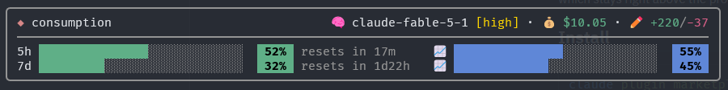

<h1 align="center">consumption-bar</h1>

<p align="center"><em>What this session is spending, in one card above the prompt.</em></p>

<p align="center">
  <a href="https://github.com/epommier/cm-consumption-bar/tags"></a>
  <a href="https://github.com/epommier/cm-consumption-bar/actions/workflows/ci.yml"></a>
  <a href="LICENSE"></a>
  <a href="https://claude.com/claude-code"></a>
</p>

<p align="center">
  <b><a href="#install">Install</a></b> · <b><a href="#what-you-see">What you see</a></b> · <b><a href="#behaviour">Behaviour</a></b> · <b><a href="#develop">Develop</a></b> · <b><a href="CHANGELOG.md">Changelog</a></b>
</p>

<p align="center"></p>

## TL;DR

A [Claude Code](https://claude.com/claude-code) mod. One card, always above the prompt:

- the model, its effort level, the session cost, and the lines you added and removed;
- one bar per rate-limit window (5h, 7d, any other your plan reports), with a countdown to the reset;
- a forecast of where each window will land by its reset, learned from your own pace.

```sh
claude plugin marketplace add https://github.com/epommier/cm-consumption-bar
claude plugin install consumption-bar@cm-consumption-bar
```

It draws no context window. Pair it with [context-bar](https://github.com/hamzafer/claude-code-mods), which sits right under this card.

## Install

Needs Claude Code 2.1.287 or newer.

```sh
claude plugin marketplace add https://github.com/epommier/cm-consumption-bar
claude plugin install consumption-bar@cm-consumption-bar
```

Try it on a checkout without installing:

```sh
claude --plugin-dir mods/consumption-bar
```

## What you see

| Part | Reads as | Meaning |
|---|---|---|
| 🧠 model `[effort]` | `claude-fable-5-1 [high]` | The current model and the effort level the last request reported. |
| 💰 cost | `$10.05` | What this session has cost so far. |
| ✏️ lines | `+220/-37` | Lines added and removed by `Edit` and `Write` this session, subagents included. |
| Window bar | `5h ████░░ 52% resets in 17m` | How much of the window is used, and when it resets. The countdown moves every minute. |
| 📈 forecast | `████░░ 55%` | Where the window should land by its reset, at your pace. |

### Colours

| Signal | Green | Yellow | Red |
|---|---|---|---|
| Window badge | below 75% | 75% and up | 90% and up |

| Effort | low | medium | high | xhigh | max |
|---|---|---|---|---|---|
| Colour | gray | blue | yellow | orange | red |

## Behaviour

- **Forecast.** Blends your usual pace, the median peak of your last 8 finished windows, with the current window's own rate, which takes over as the window runs. Until a window has finished, the pace defaults to 50% at reset. Right after a reset, when nothing can be projected yet, the column shows an empty gray bar with `--%` so the rows keep lining up. The forecast disappears when the row is too narrow to draw it.
- **Remembers.** Effort and line counts survive restarts and resumes. The learned pace is shared across sessions. Saved sessions older than 7 days are pruned.
- **Hides itself** when nothing is measured yet (for instance right after `/clear`), while a survey is open, and when the prompt body is narrower than 24 columns. Off a subscription there are no windows, so only the header shows.
- **Fails soft.** If the engine reports an error, the card shows less. It never breaks the prompt.

## Develop

```sh
claude plugin validate mods/consumption-bar
claude plugin test mods/consumption-bar
```

Inside a running Claude session the tests may refuse to run. Use a scratch config:

```sh
CLAUDE_CONFIG_DIR=$(mktemp -d) claude plugin test mods/consumption-bar
```

CI runs validate and test on every push. See [CHANGELOG.md](CHANGELOG.md) for the version history.

## License

MIT, see [LICENSE](LICENSE).
